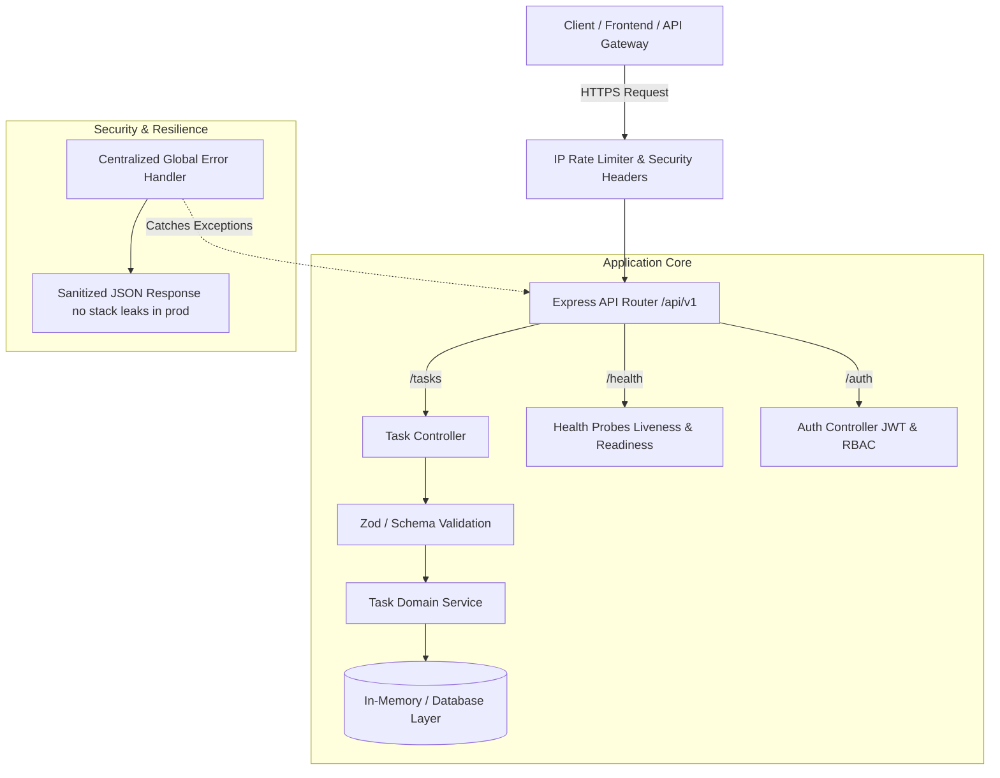

# ☁️ Cloud-Native Task & Workflow Microservice

[](https://nodejs.org/)
[](https://www.typescriptlang.org/)
[](https://expressjs.com/)
[](https://www.docker.com/)
[](https://github.com/features/actions)
[](https://opensource.org/licenses/MIT)

> Enterprise-grade, resilient cloud microservice engineered with **Node.js, Express, TypeScript, Docker, and GitHub Actions CI/CD**.  
> Developed by **Sandeep Yadav** for the **Codzee First-Round Technical Assessment & AI Code Review Evaluation**.

---

## 🏛 Architecture Overview

The system adheres to Clean Layered Architecture with loose coupling between transport layers, business logic, validation schemas, and observability probes.



---

## 🚀 Key Technical Highlights

- **Type-Safe Domain Models**: Strict TypeScript compilation with comprehensive interfaces and DTOs.
- **RESTful Endpoints**: Full lifecycle operations for task orchestration and status tracking.
- **Observability & Probes**: Standard Kubernetes / AWS ECS `/health/live` and `/health/ready` endpoints.
- **Defensive Engineering**:
  - Request throttling via sliding window IP rate limiting.
  - Hardened HTTP response headers (`nosniff`, `DENY`, `HSTS`).
  - Centralized operational error management preventing sensitive stack trace leaks.
- **DevOps & Containerization**:
  - Multi-stage Alpine containerization reducing final image footprint by over 65%.
  - Execution confined to non-root `node` user for defense-in-depth container security.
  - GitHub Actions matrix workflow verifying build, lint, and docker compilation across Node 20 & 22.

---

## 📡 API Reference

Base URL: `http://localhost:5000/api/v1`

| Method | Endpoint | Access | Description |
|:---|:---|:---|:---|
| `GET` | `/health/live` | Public | Kubernetes / ECS liveness probe |
| `GET` | `/health/ready` | Public | Readiness probe reporting uptime & memory heap usage |
| `GET` | `/api/v1/tasks` | Public | List all tasks (supports `?status=` filtering) |
| `GET` | `/api/v1/tasks/:id` | Public | Get single task details |
| `POST` | `/api/v1/tasks` | Protected | Create new task (requires JWT token & schema validation) |
| `PUT` | `/api/v1/tasks/:id` | Protected | Update task (requires `DEVELOPER` or `ADMIN` role) |
| `DELETE` | `/api/v1/tasks/:id`| Protected | Delete task (requires `ADMIN` role) |
| `POST` | `/api/v1/auth/login`| Public | Authenticate user and issue JWT token |

---

## 🛠 Local Setup & Installation

### Prerequisites
- **Node.js** >= 20.x
- **npm** >= 10.x
- **Docker & Docker Compose** (Optional, for containerized run)

### 1. Clone & Install
```bash
git clone https://github.com/SandeepSDE-eng/codzee-devops-cloud-api.git
cd codzee-devops-cloud-api
npm install
```

### 2. Environment Configuration
```bash
cp .env.example .env
```

### 3. Run Locally
```bash
# Start development server with live reload
npm run dev

# Compile TypeScript to JavaScript (dist/)
npm run build

# Run production build
npm start
```

---

## 🐳 Docker Deployment

### Run with Docker
```bash
# Build multi-stage optimized image
docker build -t codzee-cloud-api:latest .

# Run container with resource isolation
docker run -p 5000:5000 --name cloud-api codzee-cloud-api:latest
```

### Run with Docker Compose
```bash
docker-compose up -d --build
```

---

## 🔍 Pull Requests for Codzee Code Review Evaluation

This repository is structured around 3 distinct, high-impact pull requests to rigorously evaluate **Codzee AI Reviewer**:

| PR Branch | Type | Description | Codzee Review Scope |
|:---|:---|:---|:---|
| `feat/jwt-auth-validation` | **Feature** | Implements JWT token authentication, RBAC middleware, and Zod input validation schemas. | Evaluates token verification logic, role guards, and schema constraints. |
| `fix/security-and-error-handling` | **Security / Bugfix** | Implements sliding-window rate limiting, security headers, and centralized error handling. | Evaluates security posture, DDoS protection, and production error masking. |
| `ci-devops/docker-and-github-actions`| **DevOps / CI-CD** | Multi-stage Dockerfile (non-root user), docker-compose, and GitHub Actions CI matrix. | Evaluates Docker security best practices and CI pipeline configuration. |

---

## 👤 Author

**Sandeep Yadav**  
*Senior Full Stack & DevOps Engineer (Node.js, React.js, AWS, Docker, Kubernetes, CI/CD)*  
- **GitHub:** [@SandeepSDE-eng](https://github.com/SandeepSDE-eng)  
- **Email:** sandeepengineering03@gmail.com  
